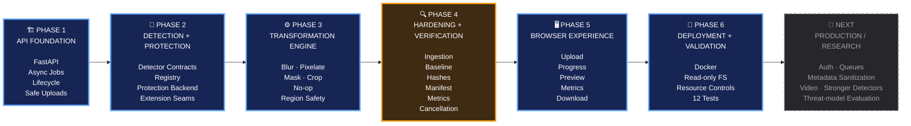
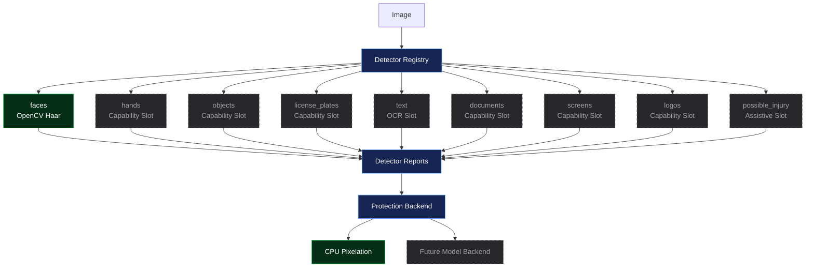
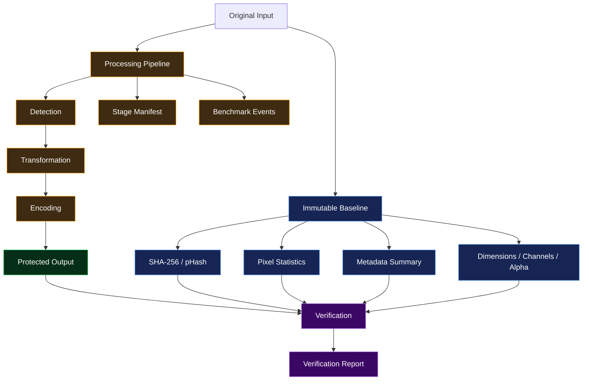

# Veil — Privacy Media API

> **Local-first privacy media prototype — CPU-first, modular, and verification-oriented.**

Veil accepts an image, detects visible regions, applies a deterministic privacy transformation, verifies the generated output, and returns a protected copy together with processing metrics.

It is intentionally designed as a **clear foundation for privacy-aware image processing**, not as a finished production security service. It does not download model weights at startup, does not claim universal face-recognition evasion, and does not provide medical or security certification.

**Stack:** Python 3.11+ · FastAPI · OpenCV · NumPy
**Runtime:** CPU-first · Local-first · Optional model seams · Docker-ready

---

# 🧭 Development Roadmap

The project evolved through six major engineering phases.



### Progress at a glance

| Phase    | Focus                                     | Status     |
| -------- | ----------------------------------------- | ---------- |
| **1**    | Product foundation & local-first API      | ✅ Complete |
| **2**    | Detection & protection architecture       | ✅ Complete |
| **3**    | Deterministic transformation engine       | ✅ Complete |
| **4**    | Reproducibility, verification & hardening | ✅ Complete |
| **5**    | Browser experience                        | ✅ Complete |
| **6**    | Deployment & automated validation         | ✅ Complete |
| **Next** | Production hardening / expanded research  | 🔭 Future  |

---

# ⭐ Project Contribution Spotlight

The current repository was delivered by **Aymen Alioua** in commit `20bd375`:

> `Build modular privacy media analysis pipeline`
> **October 1, 2026**

This contribution adds the **complete working prototype**, including:

```text
FastAPI service
      │
      ├── Asynchronous job processing
      │
      ├── Modular detector architecture
      │
      ├── Deterministic protection engine
      │
      ├── Reproducibility + verification layer
      │
      ├── Browser interface
      │
      ├── Container deployment
      │
      └── Automated validation
```

The implementation deliberately separates detection from protection, allowing the CPU-friendly OpenCV face detector and pixelation backend to work immediately while leaving stable interfaces for future detectors and research-grade protection backends.

---

# 🔄 Complete Processing Pipeline

Every successful image job follows the same staged pipeline:


The original input is preserved in memory for comparison. Temporary job data is cleaned after processing, and old temporary files are removed when a new job is submitted.

---

# 🏗️ Phase 1 — Product Foundation & Local-First API

### Goal

Turn the concept into a usable local service with a complete request lifecycle.

### Work delivered

The FastAPI foundation provides:

* Application initialization in `app/main.py`
* Health endpoint
* Capability endpoint
* Job creation
* Job status
* Protected-output download
* Multipart image uploads
* UUID-based job records
* Explicit job states:

  * `queued`
  * `processing`
  * `completed`
  * `failed`
* Bounded `ThreadPoolExecutor`
* Default single-worker execution
* Upload-size limits
* Filename sanitization
* Validated temporary paths
* Automatic temporary-file expiry

Supported API uploads at this stage are:

* JPEG
* PNG
* WebP

### Engineering result

The project obtained a complete end-to-end lifecycle:

```text
Upload
  ↓
Create Job
  ↓
Process Asynchronously
  ↓
Poll Status
  ↓
Inspect Result
  ↓
Download Protected Image
```

This established the service foundation before adding more sophisticated processing behavior.

---

# 🧩 Phase 2 — Detection & Protection Architecture

### Goal

Separate **what is detected** from **how detected regions are protected**.

This is one of the most important architectural decisions in the project.



### Detector contracts

`app/analysis/types.py` defines immutable contracts for:

* `Region`
* `Detection`
* `DetectorReport`

### Registry

`app/analysis/registry.py` provides explicit detector registration and selection.

### Current capability matrix

| Detector          | State                    |
| ----------------- | ------------------------ |
| `faces`           | ✅ OpenCV Haar cascade    |
| `hands`           | 🧩 Capability slot       |
| `objects`         | 🧩 Capability slot       |
| `license_plates`  | 🧩 Capability slot       |
| `text`            | 🧩 OCR slot              |
| `documents`       | 🧩 Capability slot       |
| `screens`         | 🧩 Capability slot       |
| `logos`           | 🧩 Capability slot       |
| `possible_injury` | 🧩 Assistive visual slot |

Unavailable detectors explicitly return `available=false` with a reason rather than pretending that analysis occurred. The `possible_injury` slot is explicitly not a medical diagnosis.

### Protection abstraction

`app/protection/base.py` establishes the protection backend contract.

The current working backend is:

> **CPU pixelation**

`app/protection/model_adapter.py` provides an adapter seam for future PyTorch, ONNX Runtime, or other loaded model functions.

The important architectural result is that **detectors and protection methods can evolve independently**.

---

# ⚙️ Phase 3 — Deterministic Transformation Engine

### Goal

Create reusable, predictable transformations that operate on detector-generated regions.

Implemented in:

```text
app/analysis/transformations.py
```

### Current transformations

| Transformation    | Behavior                                 |
| ----------------- | ---------------------------------------- |
| `leave_unchanged` | Returns a copy without modifying regions |
| `blur`            | Bounded Gaussian blur                    |
| `pixelate`        | Downscale → nearest-neighbor upscale     |
| `mask`            | Fixed privacy-color fill                 |
| `crop`            | New canvas around union of valid regions |

### Region safety

Before transformation:

```text
Detected Region
      ↓
Clamp to image bounds
      ↓
Validate
      ↓
Transform
      ↓
Report changes
```

The transformer:

* clamps regions to image bounds
* preserves source-array immutability
* reports changed-region count
* reports changed-pixel count

This makes the transformation layer reusable rather than coupling privacy behavior directly to a particular detector.

---

# 🔍 Phase 4 — Reproducibility, Verification & Hardening

## ⭐ Main engineering contribution

This is where the project becomes more than **"upload an image → blur a face."**

The hardening layer makes the processing **inspectable, reproducible, and measurable** instead of treating the resulting image as an unexplained artifact.

---

## 1. Safe ingestion

`app/analysis/ingestion.py`

* Validates file signatures before decoding
* Detects recognized-but-undecodable formats
* Rejects unsupported decoding rather than silently accepting it
* Enforces `MAX_IMAGE_PIXELS`

---

## 2. Metadata inspection

`app/analysis/metadata.py`

Inspects metadata indicators including:

* EXIF
* XMP
* IPTC
* ICC
* PNG chunks

### Important boundary

The current phase **does not remove metadata**.

It reports metadata.

Metadata sanitization is intentionally reserved for a future explicit operation with its own behavior and tests.

---

## 3. Immutable baseline

Before transformation, Veil records a baseline containing:

* SHA-256 of original bytes
* Original file size
* Recognized format
* Width
* Height
* Channels
* Alpha presence
* Color layout
* Metadata summary
* Mean pixel values
* Standard deviation
* Minimum / maximum pixel values
* Perceptual hash

This creates a measurable reference point for the rest of the pipeline.

---

## 4. Verification layer

After processing, Veil can compare the output against the baseline using:

* SHA-256
* dimensions
* changed-pixel percentage
* PSNR
* SSIM
* pHash distance
* alpha changes
* color-information changes
* metadata differences

Only metrics that can actually be computed are reported.

---

## 5. Stage-by-stage manifest

`app/analysis/manifest.py`

Records processing operations with:

* status
* parameters
* duration
* failure information

This means the output is accompanied by a **processing history**, not just an image.

---

## 6. Cancellation

`app/analysis/cancellation.py`

Cancellation is supported at safe pipeline stage boundaries rather than being treated as an uncontrolled interruption.

---

## 7. Structured benchmarking

`app/analysis/benchmark.py`

Records structured benchmark events covering:

* elapsed time
* CPU time
* memory
* detector count
* transformation count

---

## Verification architecture



---

# 🖥️ Phase 5 — Browser Experience

### Goal

Expose the processing pipeline through a simple local browser workspace instead of requiring API/CLI interaction.

The browser client lives under:

```text
app/static/
├── index.html
├── app.js
└── styles.css
```

### User flow

```text
📁 Select Image
      ↓
🔎 Detect
      ↓
🛡️ Protect
      ↓
📊 Inspect
      ↓
⬇️ Download
```

### Implemented interface

* File selection
* Drag-and-drop
* Client-side validation
* Job submission
* Progress polling
* Protected-image preview
* Metrics display
* Reset
* Download

The interface explicitly communicates the three user-facing steps:

> **Detect → Protect → Inspect**

It also preserves the project's limitation that privacy protection is not guaranteed against every detector or recognition system.

---

# 🐳 Phase 6 — Deployment & Operational Safety

### Goal

Make the prototype reproducible and runnable inside a controlled container.

### Docker implementation

The repository includes:

* Python 3.11 slim base
* OpenCV runtime dependencies
* FFmpeg runtime dependencies
* constrained worker behavior
* Docker Compose configuration
* named job-data volume
* read-only application filesystem
* temporary `/tmp` filesystem
* `no-new-privileges`

### Deployment model


These are **baseline protections**, not a complete public-service security model. A real deployment would still require authentication, authorization, rate limiting, TLS, encrypted storage, malware/content scanning, stronger resource isolation, observability, and a deliberate retention policy.

---

# 🧪 Automated Validation

The repository currently contains **12 automated tests**.

```text
12 passed
```

The test suite covers:

* Core image processing
* Metrics
* Text redaction helper behavior
* Model protection adapter contract
* Upload acceptance
* Detector registry selection
* Confidence clamping
* Region transformation safety
* No-op transformation behavior
* Optional-detector availability
* Medical disclaimer behavior
* Image signature handling
* Dimension handling
* PNG metadata inspection
* Deterministic repeated execution
* Baseline verification
* Output verification
* Encoding fallback
* Cancellation reporting

This gives the prototype an actual validation layer instead of relying solely on manual browser testing.

---

# 🧱 Architecture at a Glance

```mermaid
flowchart TD

    API["FastAPI API"]

    API --> EXEC["Pipeline Executor"]

    EXEC --> INGEST["Ingestion"]
    EXEC --> META["Metadata"]
    EXEC --> SNAP["Baseline Snapshot"]
    EXEC --> ANALYSIS["Detector Registry"]
    EXEC --> TRANSFORM["Transformation Engine"]
    EXEC --> ENCODE["Encoding"]
    EXEC --> VERIFY["Verification"]
    EXEC --> CANCEL["Cancellation"]
    EXEC --> STATUS["Status"]

    ANALYSIS --> FACE["OpenCV Face Detector"]
    ANALYSIS --> OPTIONAL["Optional Detector Slots"]

    TRANSFORM --> PIX["Pixelate"]
    TRANSFORM --> BLUR["Blur"]
    TRANSFORM --> MASK["Mask"]
    TRANSFORM --> CROP["Crop"]
    TRANSFORM --> NOOP["Leave Unchanged"]

    VERIFY --> HASH["SHA-256 / pHash"]
    VERIFY --> IMAGE["PSNR / SSIM"]
    VERIFY --> META_DIFF["Metadata Differences"]

    EXEC --> BENCH["Benchmark Events"]
    EXEC --> MANIFEST["Processing Manifest"]

    API --> UI["Browser UI"]

    classDef api fill:#172554,color:#fff,stroke:#60a5fa,stroke-width:3px;
    classDef module fill:#27272a,color:#fff,stroke:#71717a;
    classDef detector fill:#052e16,color:#fff,stroke:#22c55e;
    classDef transform fill:#3f2a12,color:#fff,stroke:#f59e0b;
    classDef verify fill:#3b0764,color:#fff,stroke:#c084fc;

    class API,EXEC api;
    class INGEST,META,SNAP,ANALYSIS,ENCODE,CANCEL,STATUS,BENCH,MANIFEST,UI module;
    class FACE,OPTIONAL detector;
    class TRANSFORM,PIX,BLUR,MASK,CROP,NOOP transform;
    class VERIFY,HASH,IMAGE,META_DIFF verify;
```



---

# 📁 Repository Structure

```text
app/
├── main.py                    FastAPI app and job lifecycle
├── config.py                  Environment-backed settings
├── schemas.py                 API response models
├── storage.py                 Safe paths and expiry cleanup
│
├── analysis/
│   ├── browser.py             Browser/WASM adapter guidance seam
│   ├── cancellation.py        Cancellation token and exception
│   ├── detectors.py           Face detector + optional slots
│   ├── executor.py            Full staged executor
│   ├── hashing.py             SHA-256, pHash, pixel statistics
│   ├── ingestion.py           Signature detection + limits
│   ├── manifest.py            Operation manifest
│   ├── metadata.py            Metadata inspection
│   ├── pipeline.py            Detector/transformation orchestration
│   ├── registry.py             Detector plugin registry
│   ├── snapshot.py             Immutable baseline
│   ├── status.py               Result status values
│   ├── transformations.py     Region transformations
│   ├── types.py                Shared detector contracts
│   └── verification.py        Output verification
│
├── modules/
│   ├── images.py               Image compatibility facade
│   ├── text.py                 Optional text redaction helper
│   ├── video.py                Future video-processing seam
│   └── ffmpeg.py               FFmpeg integration seam
│
├── protection/
│   ├── base.py                 Protection backend contract
│   └── model_adapter.py        Optional model backend adapter
│
└── static/                     Browser client

tests/
├── test_core.py
├── test_analysis.py
└── test_hardening.py
```

---

# 🔌 Extension Architecture

The project was designed so additional capabilities can be added without rewriting the core API.

## Add a detector

Implement the detector contract and register it through `default_registry()`.

A detector returns:

* detector name
* version
* detections
* labels
* confidence
* pixel-space regions
* optional metadata

Confidence values are constrained to `[0, 1]`.

---

## Add a protection model

`ModelProtectionBackend` provides the integration seam.

Model weights are intentionally **not bundled** with the prototype.

A model backend must return a same-shape `uint8` BGR image.

---

## Add a transformation

New transformations must:

1. Register the action name.
2. Implement the transformation behavior.
3. Preserve source immutability.
4. Clamp regions.
5. Return an accurate transformation report.

---

## Browser / WebAssembly

`app/analysis/browser.py` documents the shared result-schema direction for a future Web Worker/WASM adapter.

The intended architecture allows browser-side processing to reuse detector reports while sending only selected regions or transformed output to the API.

---

## Video + text

The repository already contains groundwork for future capabilities:

* `app/modules/video.py` — bounded frame sampling and IoU tracking helpers
* `app/modules/text.py` — privacy-oriented text redaction helpers
* `app/modules/ffmpeg.py` — FFmpeg integration seam

These are **not currently exposed as public API routes**.

---

# 📊 Current State

```text
                    VEIL
                     │
          ┌──────────┴──────────┐
          │                     │
      WORKING NOW            DESIGNED FOR
          │                     │
   ┌──────┴──────┐        ┌─────┴─────────┐
   │             │        │               │
 FastAPI      Browser   More Detectors  More Models
   │             │        │               │
 Async Jobs    Preview  Video           WASM
   │             │        │               │
 OpenCV       Metrics   Metadata        Research
   │             │        │               │
 Pixelate     Download  Sanitization    Evaluation
   │
 Verification
   │
 Docker
   │
 12 Tests
```

---

# ⚠️ Current Limitations

The following are deliberately **not presented as completed features**:

* Public API currently processes images, not full video jobs.
* Only the OpenCV face detector is available by default.
* Optional detector slots are capability declarations, not installed models.
* AVIF may be recognized but may not decode with the installed OpenCV build.
* Metadata is reported, not stripped.
* In-memory job state is lost when the process restarts.
* Temporary outputs are local files, not encrypted object storage.
* No built-in authentication.
* No built-in rate limiting.
* No malware scanning.
* No multi-tenant isolation.
* Pixelation is a practical privacy transformation, not a guarantee against recognition systems.
* The model adapter is an integration seam; research weights and research claims are not shipped.

---

# 🔭 Future Roadmap

> **These are future phases, not completed functionality.**


The repository itself identifies these as recommended future phases rather than completed capabilities.

---

# 🛡️ Security & Privacy Position

Veil is a prototype.

Before exposing it to untrusted public traffic, the deployment should add:

* authentication
* rate limiting
* encrypted transport
* encrypted storage
* uploaded-content scanning
* worker isolation
* resource controls
* explicit retention rules
* auditing of optional detector/model backends

A protected image should **not** be treated as guaranteed anonymous.

---

# 📚 API

### `GET /health`

Returns service health and configured baseline backend.

```json
{
  "status": "ok",
  "backend": "pixelate-cpu",
  "device": "cpu"
}
```

### `GET /api/v1/capabilities`

Returns available detectors and supported transformations.

### `POST /api/v1/jobs`

Creates an asynchronous image-processing job.

Supported fields:

* `file`
* `detectors`
* `transform`

### `GET /api/v1/jobs/{job_id}`

Returns job state and, for completed jobs:

* metrics
* detector reports
* processing manifest
* baseline
* verification data

### `GET /api/v1/jobs/{job_id}/download`

Downloads the protected output after completion.

---

# 🚀 Running Locally

## Windows PowerShell

```powershell
python -m venv .venv
.\.venv\Scripts\Activate.ps1
pip install -r requirements.txt
uvicorn app.main:app --reload
```

## Linux / macOS

```bash
python3 -m venv .venv
source .venv/bin/activate
pip install -r requirements.txt
uvicorn app.main:app --reload
```

Then open:

```text
Browser UI       http://127.0.0.1:8000/
Swagger          http://127.0.0.1:8000/docs
Capabilities     http://127.0.0.1:8000/api/v1/capabilities
```

---

# 🐳 Docker

```bash
docker compose up --build
```

The Compose deployment exposes the API locally on port `8000`, uses one worker, applies the upload limit, stores temporary data in `/service/data`, uses a named volume, keeps the application filesystem read-only, and mounts `/tmp` as temporary storage.

---

# 🧪 Tests

```bash
pytest -q
```

Current repository validation:

```text
12 passed
```

The test suite covers core processing, detector extensibility, ingestion, verification, fallback behavior, deterministic execution, and cancellation.

---

# 📜 License & Provenance

No license file is currently present in the repository.

An explicit license should be added before distributing the project.

The current implementation and repository contribution are attributed to **Aymen Alioua** through the repository's current Git commit metadata.
